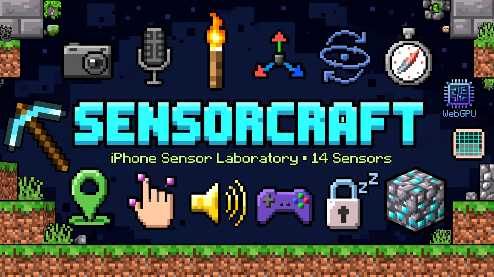

# ⛏️ SENSORCRAFT

### 🧱 把你的 iPhone，变成一座 Minecraft 风格的传感器实验室

> 📱 一台手机，十五种感官，一个方块世界等你来挖。  
> 不用装 App，打开 Safari 就能开始冒险 —— 摄像头、声音、重力、方向、位置，全部变成可以玩的方块。


---

## 🎮 这是什么？

**SENSORCRAFT** 是一个单页 Web App，把 iPhone 藏起来的传感器全部挖出来，做成一张张 Minecraft 风格的卡片。

每张卡片都先**探测**、再**渲染**：浏览器不支持就老实告诉你，不会假装能用；离开卡片时，摄像头、麦克风、传感器监听和动画循环都会自动释放，绝不偷偷在后台跑。

| | |
|---|---|
| ✅ **15 张可用 / 受限卡片** | 摄像头、麦克风、补光灯、加速度计、陀螺仪、姿态与指南针、GPS、多点触控、扬声器 / 语音、游戏手柄、屏幕常亮、WebGPU、手动相机、Face ID 信息卡、人面识别 |
| 🔒 **12 张未解锁卡片** | 环境光、磁力计原始数据、气压计、距离传感器、LiDAR、Web Bluetooth、NFC、USB / 串口、震动、电池、HealthKit、后台运行 —— 点开会告诉你为什么锁住，以及用什么替代 |

---

## ✨ 十五张卡片，一张比一张好玩

| 卡片 | 能玩什么 |
|---|---|
| 📷 **摄像头** | 前后切换、拍照、复制中心色值、暂停 / 继续（暂停会释放摄像头）、实时亮度条 |
| 🎙️ **麦克风** | 开始 / 停止、峰值保持、重置峰值、灵敏度滑杆、波形 / 频谱 / 主频 / 音名 |
| 🔦 **补光灯** | 一键开关，黑夜里也能挖矿 |
| 🏃 **加速度计** | 授权、暂停 / 继续、含重力 / 线性切换、步数、峰值、摇晃 / 自由落体成就 |
| 🌀 **陀螺仪** | 授权、暂停 / 继续、零偏校准、清除零偏、峰值 RPM |
| 🧭 **姿态与指南针** | 授权、暂停 / 继续、水平归零 / 清除、指南针校准提示 |
| 🗺️ **GPS** | 开始 / 停止、清空轨迹、复制坐标、导出 GPX、轨迹 / 速度 / 海拔 / 里程 |
| 👆 **多点触控** | 多指可视化、压力显示、最大触点数、点靶反应游戏 |
| 🔊 **扬声器 / 语音** | 音调播放、波形切换、音量、TTS 声音 / 语速 / 音调 / 音量、全部停止、语音识别（iOS Safari 常返回 `service-not-allowed`，会显示原因并降级到麦克风可视化） |
| 🎮 **游戏手柄** | 双摇杆、16 键、LT / RT 扳机、震动测试 |
| 💡 **屏幕常亮** | 拉杆开关、状态、自动重新申请 |
| ⚡ **WebGPU** | 适配器检测、高性能偏好、展开特性、复制信息 |
| 📸 **手动相机** | 变焦 / 曝光补偿、对焦 / 曝光 / 白平衡模式、补光灯、重置控制、复制能力 |
| 🆔 **Face ID / Touch ID** | WebAuthn 说明、平台认证器可用性检测（不读取生物数据） |
| 😀 **人面识别** | 摄像头实时框选人面（绿框 + 置信度）、前后切换、灵敏度滑杆、肤色遮罩调试、拍照带框；三层引擎：原生 FaceDetector（仅 Chrome）→ WebGPU 肤色掩码 → CPU 肤色检测，全部本机运算不上传 |

> 🔒 **锁住的卡不是 Bug** —— 是浏览器 / 系统根本没给这个 API，卡片里会写清楚原因和替代方案，一键就能打开可用的替代卡片。

---

## 🗺️ 快速开始：三步开始冒险

> ⚠️ 浏览器不允许 `file://` 页面使用摄像头 / 麦克风 / 定位，请用本地服务器或 HTTPS。

### 🖥️ 在电脑上试玩

```bash
python3 -m http.server 8000
# 打开 http://localhost:8000
```

### 📱 在 iPhone 上实测

1. 把整个文件夹部署到任意 HTTPS 静态托管（GitHub Pages、Netlify、Cloudflare Pages 都可以）
2. 用 Safari 打开，点「开始冒险」完成运动 / 姿态授权
3. 打开卡片时，再按需允许摄像头、麦克风、定位

---

## 📦 单文件构建：一个文件带走整个世界

```bash
node build/build-standalone.mjs
# 产物：dist/sensor-craft.html
```

构建脚本把 `index.html` 引用的 CSS 与经典脚本按顺序内联，**零第三方依赖**。单文件产物仍然需要 HTTPS 才能使用媒体与定位。

---

## 🧰 背包里的文件结构

```text
├── index.html              # 外壳与脚本顺序
├── css/                    # tokens / base / layout / components / font
├── js/
│   ├── core/               # 命名空间、DOM、格式化、日志、探测、权限、常亮、注册表、生命周期
│   ├── ui/                 # 图标、成就、HUD、背包、工作台、校准门、调试日志
│   ├── sensors/            # 每个传感器一个文件 + locked.js
│   └── main.js             # 启动
├── build/                  # 单文件构建 + 字体子集脚本
├── server/                 # 可选：Cloudflare Worker / Vercel 日志代理
├── tests/                  # 手动测试清单
└── dist/                   # 构建产物（gitignore）
```

---

## ⚒️ 打造一个新传感器：三步上工作台

**1. 新建 `js/sensors/my-sensor.js`：**

```js
(function (SC) {
  SC.registerSensor({
    id: 'my-sensor',
    name: '我的传感器',
    en: 'MY SENSOR',
    group: '运动与环境',
    icon: 'compass',
    probe: function (feature) {
      return feature.geolocation
        ? { status: 'ready' }
        : { status: 'locked', reason: '当前浏览器不支持。' };
    },
    mount: function (ctx) {
      ctx.root.innerHTML = '<div class="module">…</div>';
      ctx.listen(window, 'myevent', function (event) {
        ctx.setReadout('<div class="readout-row">…</div>');
      });
      // 返回的函数会被自动清理；也可以用 ctx.onCleanup()
    }
  });
})(window.SC = window.SC || {});
```

**2. 在 `index.html` 的传感器脚本区加一行（在 `main.js` 之前）：**

```html
<script defer src="./js/sensors/my-sensor.js"></script>
```

**3. 需要样式时，在 `css/components.css` 加 `m-<id>-` 前缀的类。**

打开页面，F3 面板会显示新增卡片的探测结果。

> 🧱 **工作台守则**：不要直接操作全局 DOM id，只操作 `ctx.root`；不要创建永久定时器，用 `ctx.raf` / `ctx.interval` / `ctx.listen`；`mount` 必须通过返回值或 `ctx.onCleanup()` 注册清理。

---

## 📊 支持矩阵（简表）

| 能力 | iPhone Safari | 说明 |
|---|---|---|
| 摄像头 / 麦克风 | ✅（HTTPS） | 需用户授权 |
| 加速度计 / 陀螺仪 / 姿态 | ✅（需手势授权） | iOS 13+ |
| GPS | ✅（HTTPS） | 页面打开时有效 |
| 多点触控 | ✅ | Pointer Events |
| 音调 / TTS | ✅ | 语音识别在 iOS 常返回 `service-not-allowed`，已做降级提示 |
| 游戏手柄 | ⚠️ | 系统蓝牙连接后按任意键 |
| 屏幕常亮 | ✅（iOS 16.4+） | 需要 HTTPS |
| WebGPU | ⚠️（iOS 26+） | 可能需实验特性 |
| 补光灯 / 手动相机 | ⚠️ | iOS 通常不开放 |
| 环境光 / 气压计 / LiDAR / NFC / 蓝牙 / 串口 / 电池 / 后台 | ❌ | 见锁定卡说明 |

---

## 🐛 调试：F3 和 LOG 是你的望远镜

- 顶部 **`F3`** 按钮：安全上下文、卡片数量、FPS、常亮状态、视口。
- 右下角 **`LOG`** 按钮：打开调试日志面板。
  - **复制日志**：复制到剪贴板。
  - **提交到 GitHub**：未配置直传端点时，打开新建 Issue 页面并把完整日志复制到剪贴板；配置 Cloudflare Worker / Vercel 端点后，直接创建 Issue。token 只在服务端，不会进入网页。
  - **直传端点（可选）**：把 `server/` 部署到 Cloudflare Worker 或 Vercel，然后在 LOG 面板填写 `https://.../logs` 并保存；地址只保存在当前设备的 localStorage。详见 `server/README.md`。
  - **下载 .txt**：导出日志附件。
  - 日志包含 UA、视口、安全上下文、权限状态、当前模块、最近 200 条事件；日志会公开，不要放隐私信息。
- 控制台：`window.SENSORCRAFT` 暴露整个命名空间。
- 事件日志在左下角，像 Minecraft 聊天框一样实时滚动。

---

## ⚠️ 已知限制：先说清楚，再开始玩

- 摄像头模块不做 rPPG 心率推断，只做画面、取色与亮度。
- 人面识别是轻量肤色 + 几何模型，不是 BlazeFace / YuNet 神经网络：iPhone Safari 没有 FaceDetector API，WebGPU 只负责加速肤色掩码。正脸、光线好时最稳；侧脸、口罩、逆光、肤色近背景时可能漏检或误检。想更高精度可把 `js/sensors/face-detect.js` 的 `detectFrame()` 换成 MediaPipe / ONNX 推理，框选管线不用改。
- 页面切到后台时 Safari 会自行暂停媒体；回到前台可能需要重新点击开始。
- 锁定卡不是 bug，是浏览器 / 系统没有提供对应 API。
- 补光灯、手动对焦 / 曝光 / 变焦在 iPhone 上不稳定，代码做能力检测而不是假装成功。

---

## 🎨 素材与许可

- 英文 / 数字字体：`Monocraft`，SIL Open Font License 1.1。见 `build/fonts/Monocraft-OFL.txt`。
- 所有纹理与图标为项目内自绘 SVG / CSS，不使用 Mojang 官方素材。
- 本项目与 Mojang / Microsoft 无关联。

---

<div align="center">

### ⛏️ 拿起你的镐，开始挖吧！

**SENSORCRAFT —— 你的手机，就是下一个方块世界。** 💎

</div>
